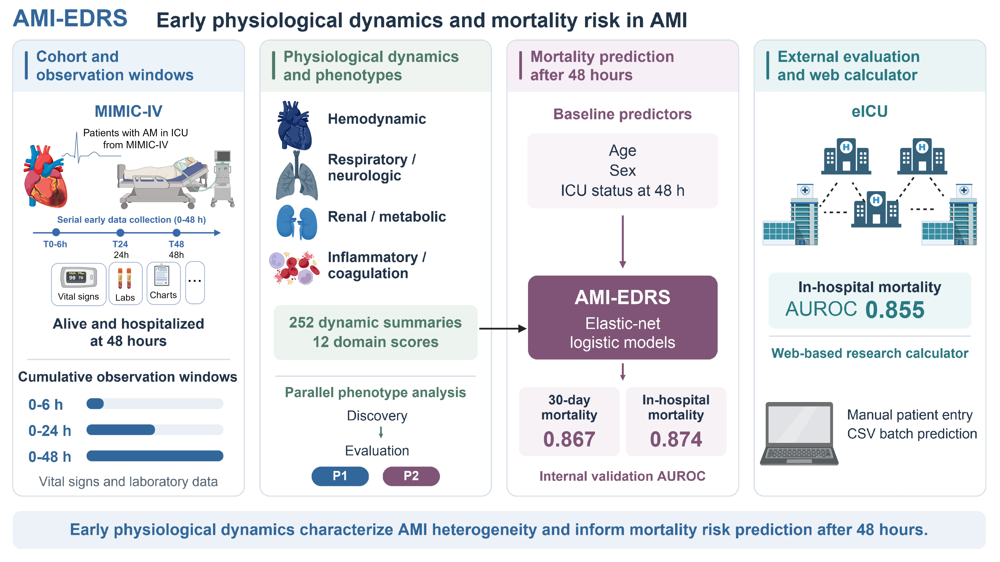

# AMI-EDRS

**Early physiological dynamics and mortality risk in ICU-admitted acute myocardial infarction**



AMI-EDRS estimates mortality risk at a 48-hour landmark using physiological measurements accumulated during the first 6, 24 and 48 hours after index ICU admission. This repository contains the research analysis, the frozen-inference implementation, and the Shiny research calculator.

[Open the research calculator](https://kangnan.shinyapps.io/ami-edrs-research) · [Analysis map](docs/ANALYSIS_MAP.md) · [Reproducibility guide](docs/REPRODUCIBILITY.md) · [Input definitions](docs/INPUTS.md)

## Study overview

- MIMIC-IV development cohort: 5,133 patients alive and hospitalized at 48 hours.
- Four physiological domains: hemodynamic; respiratory/neurologic; renal/metabolic; inflammatory/coagulation.
- Prediction model C: age, sex and ICU status at the landmark, plus 252 continuous dynamic summaries and 12 domain scores. Categorical phenotypes are not predictors in model C.
- Separate models estimate 30-day all-cause mortality after the landmark and mortality during the remaining index admission.
- Two-phenotype analysis is a parallel analysis using separate discovery and evaluation samples.
- eICU external evaluation concerns in-hospital mortality. It does not validate the 30-day mortality endpoint.

The calculator uses manual window summaries or CSV inputs. It has no automated EHR connection and has not undergone prospective clinical-impact evaluation.

## Quick start: reproducible software example

Install R, open a terminal in this repository, then run:

```sh
Rscript scripts/install_dependencies.R web
Rscript scripts/run_demo.R
Rscript scripts/run_tests.R
```

The example uses explicitly artificial observations and coefficients. It checks the same frozen scoring and inference functions used by the application; its probabilities are **software-test values, not validated AMI risk estimates**. It runs without credentialed data or trained clinical models. See [expected output](docs/DEMO.md).

## Reproduce the study analyses

Obtain authorized local copies of [MIMIC-IV 3.1](https://physionet.org/content/mimiciv/3.1/) and [eICU-CRD 2.0](https://physionet.org/content/eicu-crd/2.0/). Copy `config/local.example.R` to `config/local.R` and set your paths.

```sh
Rscript scripts/install_dependencies.R analysis
# Only when the original project inputs have not already been generated:
Rscript scripts/run_upstream.R config/local.R all
# Current analysis; stage 5 automatically runs both required correction scripts:
Rscript scripts/run_analysis.R config/local.R 1:21
```

Individual stages can be selected, for example `7:9` or `12,13,14`. Prerequisite outputs must already exist. The runner stops when a stage fails. Stage 0 is an optional legacy-file audit.

**Exact reproduction of the held-out phenotype analysis additionally requires the original frozen train/test membership file.** Its checksum remains enforced. A new random split must not be presented as reproduction of the reported held-out analysis. Historical source and the precise dependency are documented in [REPRODUCIBILITY.md](docs/REPRODUCIBILITY.md).

## Run the actual calculator locally

The public source package does not include patient-level data, cohort caches, empirical scoring reference distributions, or the trained model RDS files. The application returns no risk if its formal model is unavailable or invalid. It does not substitute the software-test model.

If you have the authors' completed frozen-model export on your own computer:

```sh
Rscript scripts/prepare_web.R /absolute/path/to/Step21
Rscript scripts/launch_web.R
```

Preparation verifies both recorded model files and runs the 34 application checks. Model files are copied only to the ignored local `work/webapp` directory. [Deployment instructions](docs/WEB_APP.md) describe the separate hosting command.

## Repository contents

| Directory/file | Contents |
|---|---|
| `analysis/` | Current cohort correction, feature engineering, model development, validation, recalibration, sensitivities, and model export |
| `upstream/` | Original raw-data extraction prerequisites, including MIMIC longitudinal input construction |
| `app/` | Current Shiny interface, frozen predictor, input dictionary and synthetic input examples |
| `scripts/` | Installation, configuration, ordered execution, demo, tests, and local app preparation |
| `tests/` | Artificial test-fixture construction; never used as a clinical fallback |
| `deployment/` | Model integrity manifest and explicit hosting helpers |
| `provenance/` | Source hashes, recorded environments, and clearly separated historical split/score source |
| `docs/` | Installation, reproduction, input definitions, code coverage, and release instructions |

Recorded analysis environment: R 4.3.2 on macOS ARM64. Package versions are retained in `provenance/environments/` and `dependencies.csv`. `install_dependencies.R` installs currently available missing packages; it does not claim to recreate the historical environment exactly. See [INSTALLATION.md](docs/INSTALLATION.md).

## Code and data availability

The source is distributed under the [MIT License](LICENSE). The bundled CSV examples are synthetic. Credentialed source data, patient membership files, model parameters and reference distributions are not redistributed in this repository. Their access and sharing follow the applicable PhysioNet conditions; see [DATA_ACCESS.md](docs/DATA_ACCESS.md).

Use a tagged release and its archived DOI when citing this code. `CITATION.cff` identifies the software; release and archive links should be added when a public repository and archival record have been created. No DOI or successful hosted CI run is claimed by this source package.
